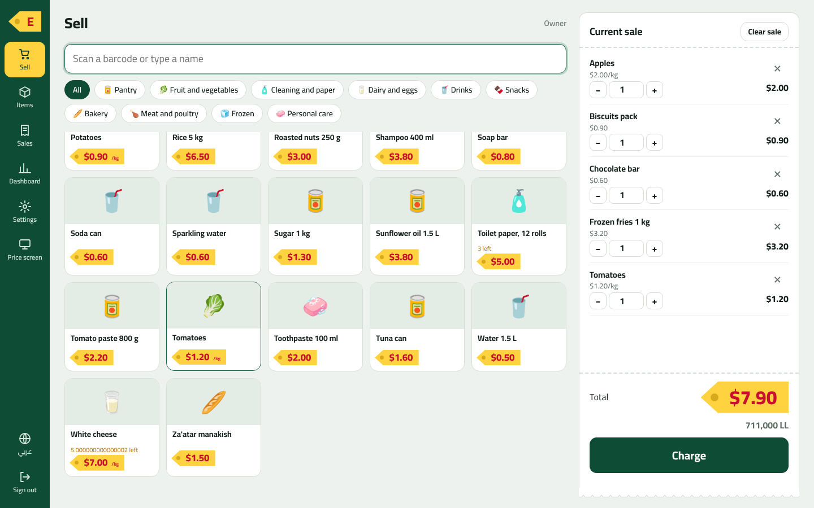
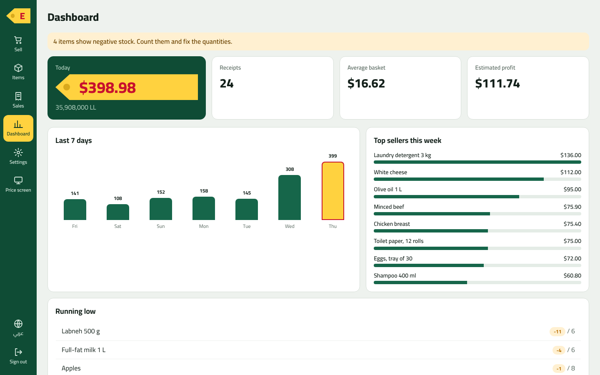
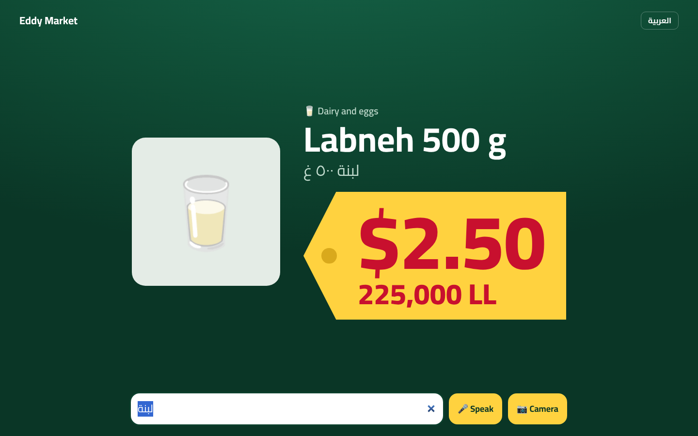

# Eddy OS

A web point-of-sale and customer price screen for supermarkets, built by Ci (Crispin Intelligence). Made first for Eddy Market, designed so other village shops can run the same system.



## What it does today
- **Till**: scan a barcode (hardware scanner or typing), tap items, charge in cash (USD or LL) or card, print a receipt. Prices live in USD with the LL equivalent shown beside them; one setting controls the rate.
- **Customer price screen** at `/kiosk`: a customer scans an item, **speaks its name**, uses the **camera**, or types, and sees the price on a shelf tag in USD and LL. It is public and read-only: it never shows cost or stock.
- **Items**: add and edit, photos, extra barcodes, kilo items, CSV import and export.
- **Dashboard** (owner): today's sales, average basket, estimated profit, 7-day chart, top sellers, low stock.
- **Team**: owner and cashier logins with PINs. Cashiers cannot see costs, edit items or open the dashboard.
- Arabic (right-to-left) and English everywhere, switchable with one tap.




## Run it
Needs Node 22.5 or newer. No packages to install.

```bash
npm start            # http://localhost:3000  and  http://localhost:3000/kiosk
npm test             # 27 end-to-end checks
```

On the first run it creates the owner and prints a **one-time owner PIN** (also saved in `data/<store>.owner-pin.txt`). Change it in Settings. `node server.js --reset-owner-pin` makes a new one.

| Variable | Default | Meaning |
|---|---|---|
| `PORT` | 3000 | Port to listen on |
| `STORE_ID` | `eddy` | Store name; data lives in `data/<STORE_ID>.db` |
| `DATA_DIR` | `./data` | Where the database is kept |
| `SEED_DEMO` | on | Set `0` to start with an empty catalogue instead of demo items |

**One shop = one instance** with its own `STORE_ID`. That keeps every supermarket's data fully separate, so selling it to other shops is just starting another instance.

### Going live
- Put it behind your Cloudflare tunnel (for example to `localhost:3000`). Camera and voice in the browser need **HTTPS**, which the tunnel provides.
- Open `/kiosk` full-screen on the customer-facing screen. Hardware scanners work with no setup: they type into the page.
- Back up by copying `data/<STORE_ID>.db` while the server is stopped, or with `sqlite3 data/eddy.db ".backup backup.db"`.

## Loading Eddy Market's real data
Items > Import CSV, with these columns: `barcode, name, name_ar, category, price_usd, cost_usd, stock, min_stock, unit, extra_barcodes`. Existing barcodes are updated, new ones are created. See `docs/DATA_FINDINGS.md` for what the old system's data looks like and what to clean first.

## Where things are
`server.js` API and database, `seed.js` demo items, `public/` till and kiosk, `test/` end-to-end test, `sql/` and `database/` reference material from the old system, `docs/` notes. Next steps are in [ROADMAP.md](ROADMAP.md).
